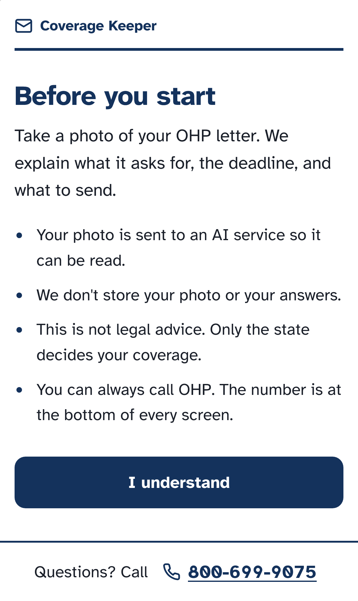
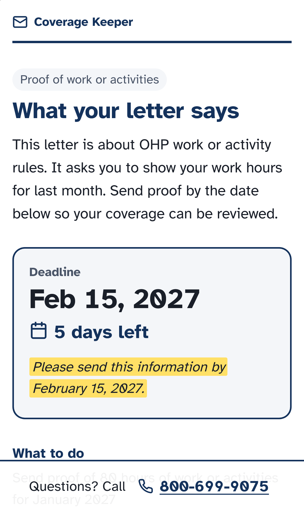
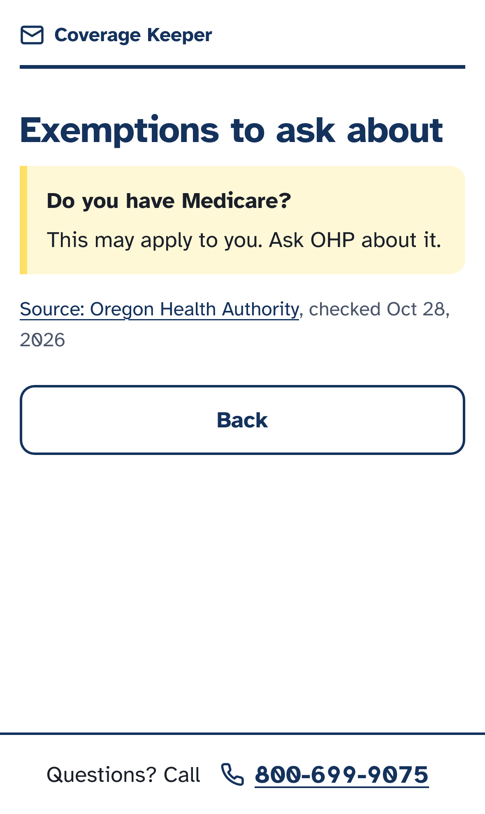
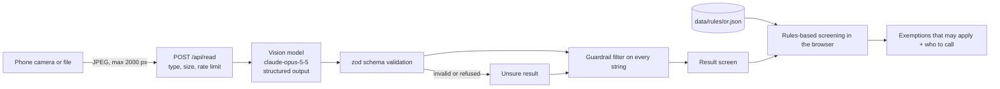

# Coverage Keeper

Photograph a Medicaid letter and learn what it asks for, when it is due, and who to call.

[](https://github.com/AdityaJadhav17/coverage-keeper/actions/workflows/ci.yml)
[](LICENSE)
[](.nvmrc)
[](https://nextjs.org/)
[](tsconfig.json)
[](https://coverage-keeper.vercel.app)
[](DEVPOST_URL_TBD)
[](#evaluation)

Solix Empower Hackathon, AI in Healthcare track.

## Demo

- Live app: [coverage-keeper.vercel.app](https://coverage-keeper.vercel.app)
- Video: [VIDEO_URL_TBD](VIDEO_URL_TBD)

| Consent                                                        | Result                                                       | Exemption screening                                               |
| -------------------------------------------------------------- | ------------------------------------------------------------ | ----------------------------------------------------------------- |
|  |  |  |

Dark mode and the doctor-note draft are in [docs/assets/screenshots/](docs/assets/screenshots/).

## The problem

When states restarted Medicaid renewals after the pandemic, most people who lost coverage lost it over paperwork, not because a state found them ineligible. KFF counted 69% of disenrollments as procedural across all states with data [1], and 66% in the final month of the unwinding [2].

Paperwork is about to grow. The July 2025 federal budget law requires Medicaid enrollees in most states to show 80 hours a month of work, volunteering or school, starting January 1, 2027 [3]. Oregon applies the rules to some adults ages 19-64 when they apply or renew, lists exemptions, and says members the rules apply to will get a notice in September 2026 [4].

A missed letter can end someone's coverage. Coverage Keeper helps the person holding that letter.

## What Coverage Keeper does

1. You agree to a consent screen that says the photo goes to an AI service, nothing is saved, and the app can't decide if you qualify.
2. You photograph or upload one page of a Medicaid letter. The browser shrinks it before upload.
3. The app shows a plain-language summary, the deadline with days left and the line it was read from, a checklist of documents to send, and a phone number to call.
4. For Oregon (OHP) letters, you answer yes/no questions from Oregon's published exemption list. The app lists the exemptions that **may** apply, with the source.
5. If you said yes to a health condition, you can draft a note to your doctor from a template, then copy or share it.

The call button stays on every screen, and so does the phone number from the letter (or OHP's 800-699-9075).

## How it works



The model only reads. It returns one fixed shape ([`src/lib/schema.ts`](src/lib/schema.ts)): notice type, summary, deadline, the quoted deadline line, required action, documents, phone and confidence. The schema has no eligibility field, so the model has nowhere to put a verdict. Exemption screening never calls the model: [`src/lib/screening.ts`](src/lib/screening.ts) returns the Oregon rules you answered yes to, and the UI says they "may apply". Only the state decides eligibility, and the app sends you to the state's phone line to ask.

## Safety and privacy

- **Never decides eligibility.** No eligibility field in the schema, fixed "may apply" wording, and a guardrail ([`src/lib/guardrails.ts`](src/lib/guardrails.ts)) that replaces any sentence like "you are eligible" or "you don't qualify" with a safe fallback and the OHP phone number. A safety test suite runs in CI and blocks the merge.
- **Nothing stored.** The photo is processed in memory and dropped after the response. No database, no accounts, no analytics.
- **Logs carry no letter content.** The route logs status, latency, model and error class only.
- **Prompt-injection defenses.** The prompt treats letter text as data, output is schema-only JSON, the guardrail runs after generation, and adversarial fixtures test it.

Details: [docs/safety-and-privacy.md](docs/safety-and-privacy.md), [ADR-0004 privacy](docs/adr/0004-privacy-retention.md), [ADR-0005 guardrails](docs/adr/0005-safety-guardrails.md).

## Evaluation

**Method.** The eval set is 13 labeled images: 10 public sample notices from state `.gov` sites (3 Oregon, 7 Vermont; page 1 of each PDF) and 3 phone photos. We fixed the split before any run: 4 dev, 9 test. The test split ran with `claude-opus-5-5` and prompt v1 [5], then again after the prompt v2 fix [6]. Nobody tuned the prompt on test failures. Scoring rules are in [docs/eval.md](docs/eval.md).

**Results (test split, 9 letters: 6 PDF renders + 3 phone photos).** Prompt v1 and prompt v2 produced the same numbers and the same failures.

| Metric                                 | Result |
| -------------------------------------- | ------ |
| Printed deadline read correctly        | 4 of 4 |
| No deadline correctly reported as none | 5 of 5 |
| Notice type correct                    | 8 of 9 |
| Required action correct                | 6 of 9 |
| Document recall (mean)                 | 1.00   |
| Document precision (mean)              | 0.83   |
| Guardrail hits                         | 0      |

**Failures.** Notice type: `vt-re005ep-renewal-decision`. Required action: `or-med005-eligibility`, `vt-ee415-work-heads-up`, `vt-ee307-renewal-ending-photo`.

**Caveats.**

- The set is small: 9 test letters.
- It is mostly Vermont. Oregon publishes only 3 sample notices online.
- Only page 1 of each notice is read.
- The 3 phone photos show a screen, not printed paper.
- 2 of the 3 photos (`vt-201p`, `vt-ee307`) show letters whose PDF versions are in the dev split.

## Tech stack

| Area         | Choice                                                                 |
| ------------ | ---------------------------------------------------------------------- |
| App          | Next.js 16 (App Router), React 19, TypeScript 6                        |
| Letter model | Anthropic `claude-opus-5-5` via `@anthropic-ai/sdk`, structured output |
| Validation   | zod 4                                                                  |
| Tests        | Vitest, fast-check, Playwright, axe-core                               |
| CI           | GitHub Actions, gitleaks, osv-scanner, Dependabot                      |
| Hosting      | Vercel                                                                 |

Decisions and trade-offs: [ADR index](docs/adr/README.md).

## Getting started

Prerequisites: Node 22 (see [`.nvmrc`](.nvmrc)) and npm. An Anthropic API key is needed only to read real letters.

```bash
git clone https://github.com/AdityaJadhav17/coverage-keeper.git
cd coverage-keeper
npm ci
cp .env.example .env.local
npm run dev
```

In `.env.local`, set `ANTHROPIC_API_KEY` to read real photos, or set `LETTER_READER=fixture` to return a recorded sample result with no network call (offline demo). Open http://localhost:3000.

| Script                     | What it does                                          |
| -------------------------- | ----------------------------------------------------- |
| `npm run dev`              | Start the dev server                                  |
| `npm run build`            | Production build                                      |
| `npm start`                | Serve the production build                            |
| `npm run lint`             | ESLint                                                |
| `npm run format`           | Prettier, write                                       |
| `npm run format:check`     | Prettier, check only                                  |
| `npm run typecheck`        | `tsc --noEmit`                                        |
| `npm test`                 | Unit tests with coverage                              |
| `npm run test:integration` | Route handler and rules data tests                    |
| `npm run test:safety`      | Guardrail suite                                       |
| `npm run test:e2e`         | Playwright journeys (build first)                     |
| `npm run eval`             | Score the reader on `eval/` (real model, costs money) |
| `npm run check:hygiene`    | Forbidden paths, eval data rules                      |
| `npm run check:licenses`   | Production dependency license allowlist               |
| `npm run audit`            | `npm audit` at high severity                          |

## Project structure

```
src/       Next.js app: pages, API routes, letter reader, guardrails, prompt  (src/README.md)
data/      Oregon exemption rules as JSON, with source URL and date          (data/README.md)
eval/      Labeled public sample notices and the scoring script              (eval/README.md)
tests/     Integration, safety and E2E tests, plus fixtures                  (tests/README.md)
docs/      Product, eval, safety, testing and CI docs, ADRs, screenshots     (docs/README.md)
scripts/   Repo hygiene check run in CI                                      (scripts/README.md)
.github/   CI, eval and security workflows, issue and PR templates
```

## Testing and CI

| Layer       | Where                                | Command                    |
| ----------- | ------------------------------------ | -------------------------- |
| Unit        | `src/**/*.test.ts`, `eval/*.test.ts` | `npm test`                 |
| Integration | `tests/integration/`                 | `npm run test:integration` |
| Safety      | `tests/safety/`                      | `npm run test:safety`      |
| E2E         | `tests/e2e/` (iPhone 15, Pixel 7)    | `npm run test:e2e`         |
| Eval        | `eval/` (real model, not in PR CI)   | `npm run eval`             |

Every pull request must pass hygiene and secret scan, dependency audit and licenses, lint/format/types, unit tests with coverage, the safety suite, integration tests, build and E2E with axe checks. Merges to `main` deploy to Vercel after all gates. See [docs/testing.md](docs/testing.md) and [docs/ci.md](docs/ci.md).

## Documentation

- [Docs index](docs/README.md)
- [Personas](docs/personas.md) and [user stories](docs/user-stories.md)
- [MVP scope](docs/mvp.md)
- [Evaluation](docs/eval.md)
- [Safety and privacy](docs/safety-and-privacy.md)
- [Testing](docs/testing.md)
- [CI/CD](docs/ci.md)
- [Architecture decision records](docs/adr/README.md)
- [Changelog](CHANGELOG.md)

## Roadmap

- Spanish UI and summaries (Oregon publishes Spanish sample notices).
- More states' exemption rules.
- Multi-page letters.
- Deadline reminders.

## Team

- Woosik Kim
- Aditya Jadhav
- Waleed Alghaithi

## Acknowledgements and sources

1. KFF, Medicaid Enrollment and Unwinding Tracker: https://www.kff.org/medicaid/issue-brief/medicaid-enrollment-and-unwinding-tracker/
2. KFF, How Did Medicaid Renewal Outcomes Change During the Unwinding?: https://www.kff.org/policy-watch/how-did-medicaid-renewal-outcomes-change-during-the-unwinding/
3. KFF Health News, 2026-06-12: https://kffhealthnews.org/medicaid/medicaid-work-requirements-final-rules-exemptions-trump-cms/
4. Oregon Health Authority, Federal changes to OHP (updated 2026-09-18): https://www.oregon.gov/oha/hsd/ohp/pages/federal-changes.aspx
5. Test split results, prompt v1, pull request #7: https://github.com/AdityaJadhav17/coverage-keeper/pull/7
6. Test split results, prompt v2, pull request #13: https://github.com/AdityaJadhav17/coverage-keeper/pull/13#issuecomment-6483248906
7. Sample notices used for evaluation: Oregon Health Authority and Vermont Department of Vermont Health Access. Each file's source URL is in [`eval/labels.json`](eval/labels.json).

## Disclaimer

Coverage Keeper is not legal advice and does not decide eligibility. It is not affiliated with the Oregon Health Authority, the Vermont Department of Vermont Health Access, or any government agency. The sample notices in `eval/` are public government documents, used here only for evaluation.

## Contributing and security

See [CONTRIBUTING.md](CONTRIBUTING.md), the [Code of Conduct](CODE_OF_CONDUCT.md) and [SECURITY.md](SECURITY.md).

## License

[MIT](LICENSE)
